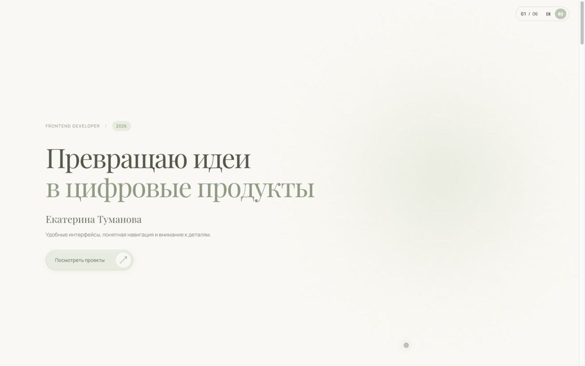
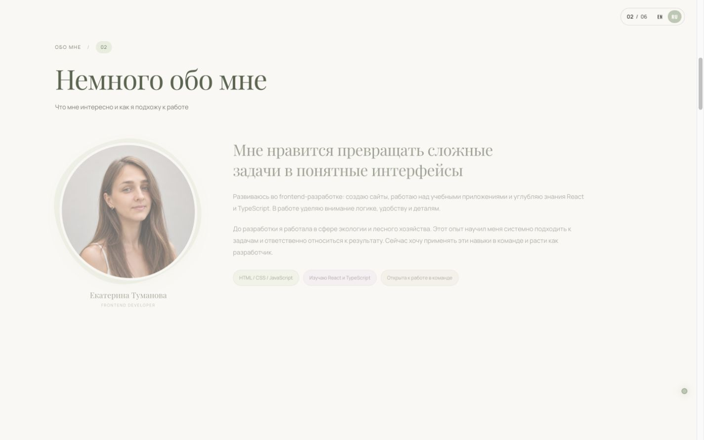
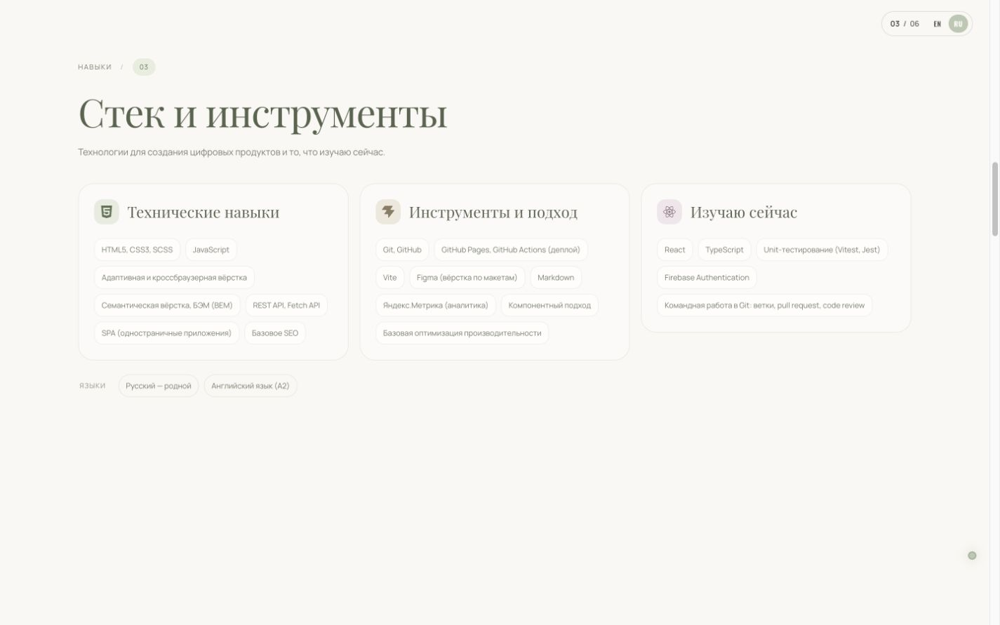
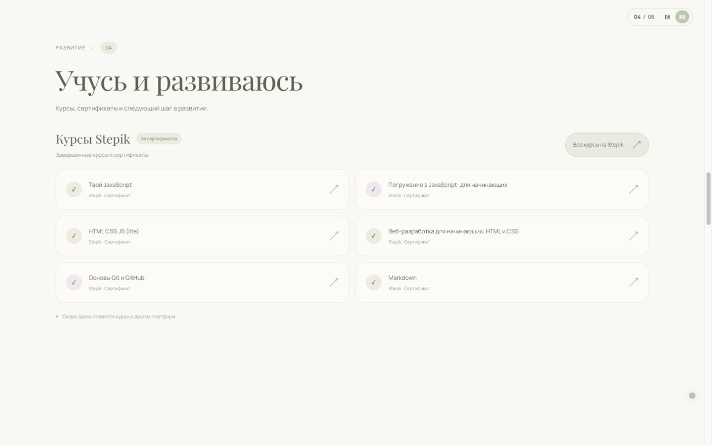
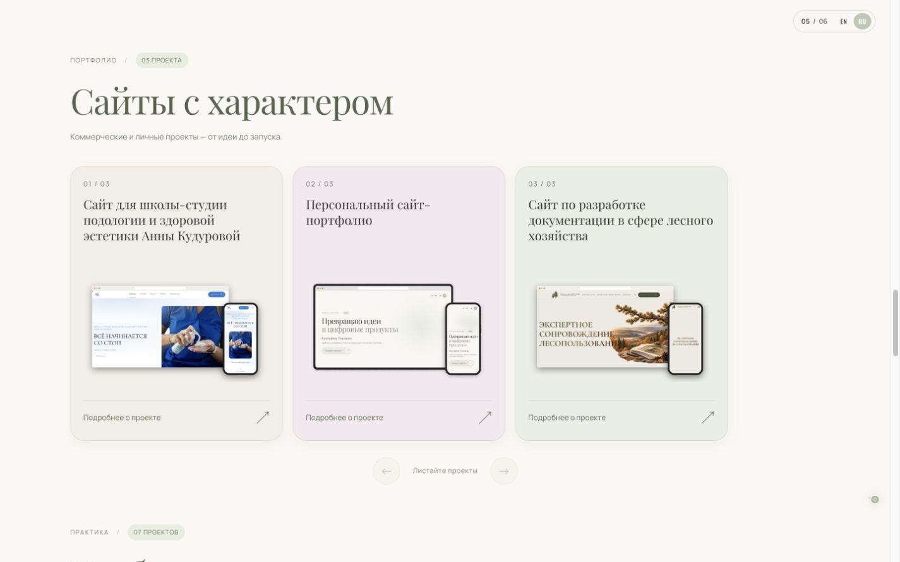
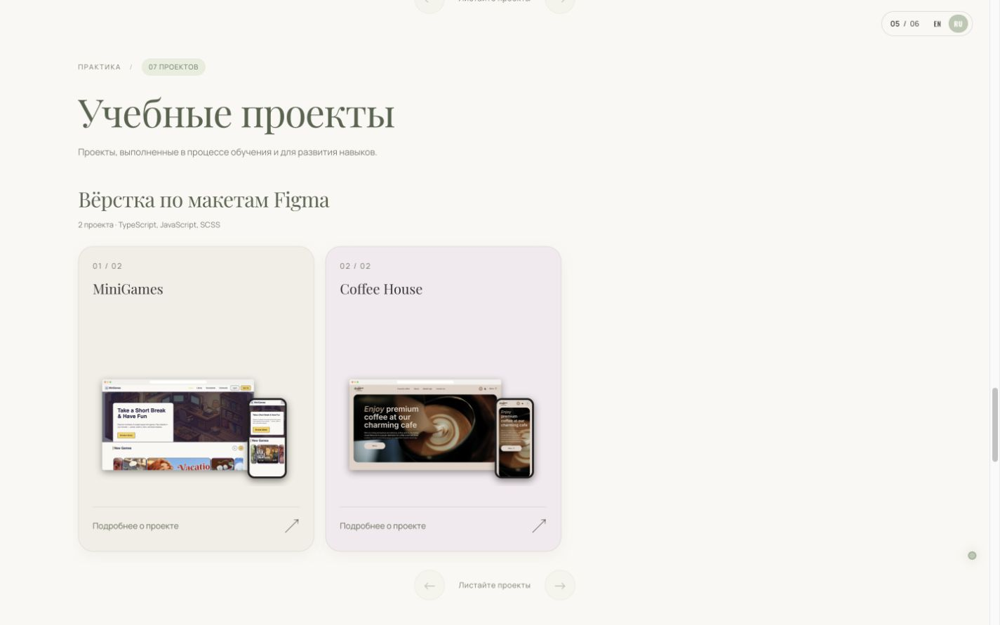
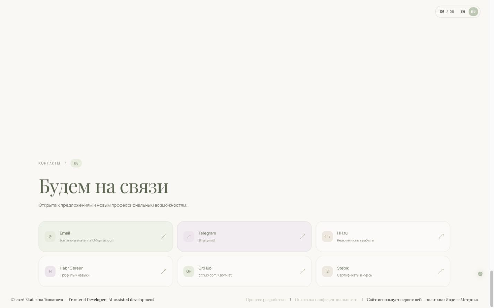
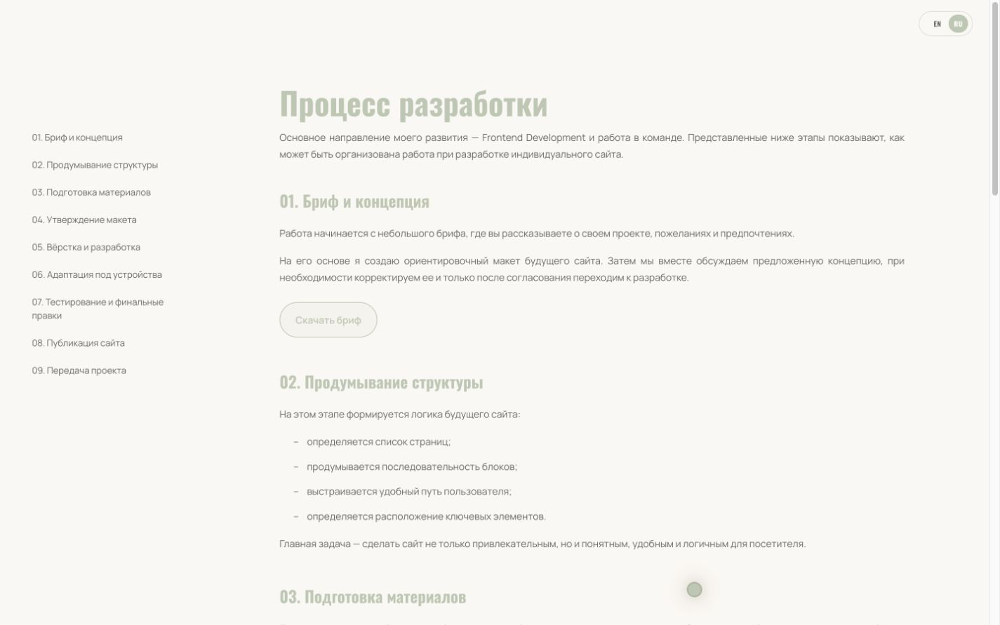
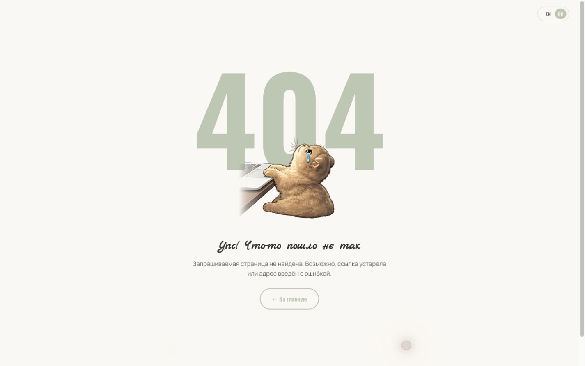
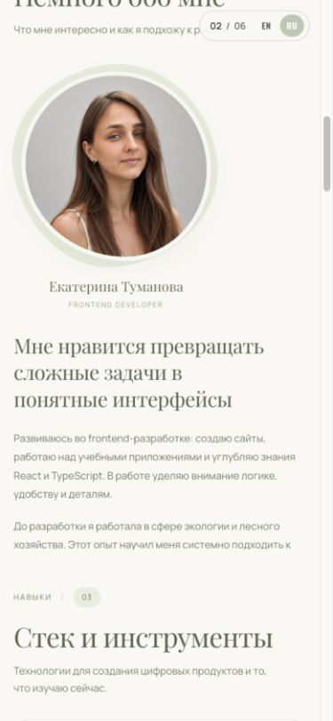

<div align="center">

# Екатерина Туманова · Ekaterina Tumanova

**Сайт-портфолио · Portfolio Website**<br>
Frontend Developer & Designer

<a href="https://katymist.github.io/Portfolio/"></a>


 

<a href="https://katymist.github.io/Portfolio/">
 
</a>

</div>

<br>

> [!NOTE]
> **О проекте.** Личный проект, созданный с нуля: идея, структура, визуальный стиль, цветовая палитра и реализация. Сайт двуязычный (RU / EN), с тёплым светлым фоном, мягкими пастельными акцентами и анимациями. Здесь собраны мой опыт, навыки, сертификаты, коммерческие и личные проекты, учебные работы и контакты.
>
> **About the project.** A personal project built from scratch, from concept and structure to visual design, color palette and implementation. The website is bilingual (RU / EN), with a warm light background, soft pastel accents and animations. It brings together my background, skills, certificates, commercial and personal projects, learning projects and contact links.

---

## О сайте · About

Одностраничный сайт-портфолио frontend-разработчика с дополнительными страницами. Задача — представить меня, показать опыт и проекты и дать удобные способы связаться. Разделы последовательно перекрывают друг друга при прокрутке; текущий раздел обозначен компактным счётчиком `01 / 06` рядом с переключателем языка.

A single-page portfolio website for a frontend developer, with supporting pages. Its goal is to introduce me, showcase my experience and projects, and offer easy ways to get in touch. Sections overlap as you scroll; a compact `01 / 06` counter beside the language switch indicates the current section. The default language is English; the saved RU / EN choice is restored on subsequent visits.

| Раздел · Section | Что в нём · Content |
|---|---|
| [Главная · Home](https://katymist.github.io/Portfolio/#hero) | «Превращаю идеи в цифровые продукты»: имя, специализация и кнопка перехода к проектам<br>“Turning ideas into digital products”: name, role and a link to projects |
| [Обо мне · About me](https://katymist.github.io/Portfolio/#about) | Опыт, подход к работе и портрет с мягким изменением контура<br>Background, approach to work and a portrait with a gently changing outline |
| [Навыки · Skills](https://katymist.github.io/Portfolio/#skills) | Технические навыки, инструменты, изучаемые технологии и языки<br>Technical skills, tools, technologies I’m learning and languages |
| [Обучение · Education](https://katymist.github.io/Portfolio/#education) | Шесть сертификатов и ссылка на профиль Stepik<br>Six certificates and a link to my Stepik profile |
| [Проекты · Projects](https://katymist.github.io/Portfolio/#projects) | Три коммерческих и личных проекта, семь учебных — в горизонтальных лентах с переворотом карточек<br>Three commercial and personal projects and seven learning projects, in horizontal flip-card galleries |
| [Контакты · Contacts](https://katymist.github.io/Portfolio/#contacts) | Email, Telegram, HH.ru, Habr Career, GitHub и Stepik<br>Email, Telegram, HH.ru, Habr Career, GitHub and Stepik |
| [Процесс · Process](https://katymist.github.io/Portfolio/process.html) | Этапы работы над сайтом и бриф для скачивания<br>Website development stages and a downloadable brief |
| [Политика · Privacy](https://katymist.github.io/Portfolio/privacy.html) | Политика конфиденциальности<br>Privacy policy |

## Проекты · Projects

В портфолио два направления: **коммерческие и личные проекты** — сайты для реальных заказчиков и собственное портфолио, и **учебные проекты** — работы для закрепления и развития навыков.

Учебные проекты разделены на три группы:

- **Вёрстка по макетам Figma**
- **React по видеоурокам, с собственным дизайном**
- **Вёрстка по видеоурокам**

На лицевой стороне карточки — название и изображение, на обороте — описание, стек и ссылки на проект и исходный код. На компьютере карточка переворачивается при наведении, на сенсорном устройстве — по нажатию. У каждой ленты есть отдельные кнопки прокрутки влево и вправо.

The portfolio has two areas: **commercial and personal projects** — client websites and my own portfolio, and **learning projects** — work created to practice and develop my skills.

Learning projects are grouped into:

- **Websites built from Figma designs**
- **React projects from video tutorials with my own design**
- **Markup projects from video tutorials**

Each card shows a title and preview on the front, with a description, tech stack, live project and source links on the back. Cards flip on hover on desktop and on tap on touch devices. Each gallery has its own previous and next buttons.

Актуальные проекты · Latest projects: [на сайте · on the website](https://katymist.github.io/Portfolio/#projects).

## Скриншоты · Screenshots

<details open>
<summary><b>Главная · Home</b></summary>
<br>

</details>

<details>
<summary><b>Обо мне · About me</b></summary>
<br>

</details>

<details>
<summary><b>Навыки · Skills</b></summary>
<br>

</details>

<details>
<summary><b>Обучение · Education</b></summary>
<br>

</details>

<details>
<summary><b>Коммерческие и личные проекты · Commercial & Personal Projects</b></summary>
<br>

</details>

<details>
<summary><b>Учебные проекты · Learning Projects</b></summary>
<br>

</details>

<details>
<summary><b>Контакты · Contacts</b></summary>
<br>

</details>

<details>
<summary><b>Процесс разработки · Development Process</b></summary>
<br>

</details>

<details>
<summary><b>Страница 404 · 404 Page</b></summary>
<br>

</details>

<details>
<summary><b>Мобильная версия · Mobile Version</b></summary>
<br>

</details>

## Возможности · Features

| Русский | English |
|---|---|
| **Два языка RU / EN** — переключатель вверху страницы, выбор сохраняется | **Two languages, RU / EN** — top-of-page switch with a remembered choice |
| **Светлое оформление** — тёплый фон, шалфейные, бежевые и розовые акценты | **Light design** — warm background with sage, beige and rose accents |
| **Адаптивная вёрстка** для компьютеров, планшетов и телефонов | **Responsive layout** for desktop, tablet and mobile |
| **Счётчик разделов `01 / 06`** обновляется при прокрутке | **Section counter `01 / 06`** updates as you scroll |
| **Перекрывающиеся разделы** с учётом высоты содержимого | **Overlapping sections** that accommodate their content height |
| **Переворачивающиеся карточки проектов** — наведение, нажатие, кнопка возврата и Escape | **Flip cards** — hover, tap, a back button and Escape |
| **Горизонтальные ленты проектов** с независимыми кнопками ← / →, сенсорной прокруткой и управлением стрелками при фокусе ленты | **Horizontal project galleries** with independent ← / → buttons, touch scrolling and arrow-key navigation when the gallery is focused |
| **Навыки видны сразу** — компактные группы без скрытых списков | **Skills visible at a glance** — compact groups without collapsed lists |
| **Карточки сертификатов** — каждая целиком ведёт на сертификат Stepik | **Certificate cards** — each entire card links to its Stepik certificate |
| **Шесть активных контактов** — Email, Telegram, HH.ru, Habr Career, GitHub и Stepik | **Six contact links** — Email, Telegram, HH.ru, Habr Career, GitHub and Stepik |
| **Мягкие эффекты наведения** и настройка уменьшенного движения для основных новых эффектов | **Subtle hover effects** and reduced-motion alternatives for the main new effects |
| **Прелоадер** с монограммой, мягкой анимацией и плавным исчезновением | **Preloader** with a monogram, subtle animation and a soft fade-out |
| **Анимация появления** отдельных блоков при прокрутке (IntersectionObserver) | **Reveal-on-scroll** animations for selected blocks (IntersectionObserver) |
| **Кастомный курсор** с мерцающим шлейфом | **Custom cursor** with a sparkle trail |
| **SVG-фавикон** с монограммой «Е» | **SVG favicon** with an “Е” monogram |
| **Страница «Процесс разработки»** с брифом для скачивания | **“Development process” page** with a downloadable brief |
| **Баннер cookies** с сохранением согласия и политика конфиденциальности | **Cookie banner** with remembered consent and a privacy policy |
| **SEO**: мета-теги, Open Graph, canonical | **SEO**: meta tags, Open Graph, canonical |
| **Яндекс.Метрика** | **Yandex.Metrica** |
| **Своя страница 404** | **Custom 404 page** |

## Технологии · Tech Stack

| | |
|---|---|
| Разметка · Markup | HTML5 |
| Стили · Styles | SCSS (Dart Sass), BEM, CSS custom properties |
| Скрипты · Scripts | Vanilla JavaScript, ES modules |
| Дизайн · Design | Figma |
| Шрифты · Fonts | Manrope, Playfair Display, Oswald, Philosopher, Marck Script (woff2) |
| Хостинг · Hosting | GitHub Pages |

## Структура проекта · Project Structure

```text
├── index.html                  # Главная: 6 разделов · Home: 6 sections
├── process.html                # Процесс разработки · Development process
├── privacy.html                # Политика конфиденциальности · Privacy policy
├── 404.html
├── favicon.svg                 # Монограмма «Е» · “Е” monogram
├── styles/
│   ├── main.scss               # Точка входа · Entry point
│   ├── main.css                # Собранные стили · Compiled styles
│   ├── blocks/                 # Стили разделов и компонентов · Section and component styles
│   └── helpers/                # Миксины, функции, медиа · Mixins, functions, media
├── scripts/
│   ├── main.js                 # Инициализация модулей · Module initialization
│   ├── i18n.js                 # Переводы RU / EN · RU / EN translations
│   ├── lang-init.js            # Восстановление языка · Saved language restoration
│   ├── section-stack.js        # Перекрытие разделов · Section stacking
│   ├── active-nav.js           # Счётчик разделов · Section counter
│   ├── commercial-gallery.js   # Ленты и переворот карточек · Galleries and card flipping
│   └── ...                     # Прелоадер, cookies, курсор · Preloader, cookies, cursor
├── images/
│   ├── readme/                 # Скриншоты и превью · Screenshots and preview
│   └── project/mockups/        # Превью проектов · Project mockups
└── icons/  fonts/
```

## Запуск локально · Running Locally

Нужны Node.js с npm; для приведённого ниже локального сервера — Python 3.

Requires Node.js with npm; the local server command below also requires Python 3.

```bash
git clone https://github.com/KatyMist/Portfolio.git
cd Portfolio
npm ci
npm run build
python3 -m http.server 5501
```

Откройте `http://localhost:5501/`. Сервер работает, пока запущена команда; остановка — `Ctrl+C`.

Open `http://localhost:5501/`. The server runs until you stop it with `Ctrl+C`.

Для разработки запустите наблюдение за SCSS в отдельном терминале, оставив локальный сервер работающим:

For development, run the SCSS watcher in another terminal while keeping the local server running:

```bash
npm run dev
```

Сборка стилей без source map · Build styles without a source map:

```bash
npm run build
```

Скомпилированный `styles/main.css` хранится в репозитории. Перед публикацией изменений SCSS нужно выполнить сборку: текущий workflow GitHub Pages публикует статические файлы без отдельного шага Sass.

The compiled `styles/main.css` is tracked in the repository. Build after changing SCSS before publishing: the current GitHub Pages workflow deploys static files without a separate Sass build step.

## Автор · Author

**Екатерина Туманова · Ekaterina Tumanova** — Frontend Developer & Designer

[Портфолио · Portfolio](https://katymist.github.io/Portfolio/) · [GitHub](https://github.com/KatyMist) · [Telegram](https://t.me/katymist) · [Stepik](https://stepik.org/users/1179792686/profile) · [HH.ru](https://ulyanovsk.hh.ru/resume/b77b4490ff107e4c760039ed1f5262426e565a)

<div align="center">
<sub>Открыта к новым возможностям · Open to new opportunities</sub>
</div>
